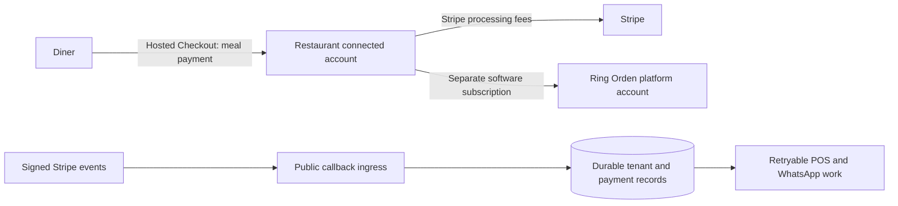

# Ring Orden — Stripe integration plan

Prepared 2026-10-27 using the official Stripe plugin, its implementation planner, current Stripe documentation, and the existing repository. This is a recommended implementation plan and code review, not a completed five-product integration.

## Confirmed context and setup

- Business: Ring Orden, ElevenLabs voice answering and order routing for independent restaurants.
- The user confirmed Mexico for the registered business and initial restaurant operations.
- Authorized environment: **RingOrden sandbox**, account `acct_1UVJlwKBRvZcBh5R`, `livemode: false`.
- Source: [ShirleyS/ring-orden](https://github.com/ShirleyS/ring-orden).
- The requested `claude plugin install stripe@claude-plugins-official` reported the plugin already installed. Its configured MCP endpoint is `https://mcp.stripe.com`; authenticated Stripe tools and the implementation planner were available. No alternative skills installation was needed.
- Planner guide `iguide_61Vei8qkxob1EK3v841KBRvZcBh5R` reached `accepted` status for the recommended hosted Checkout path and supporting Connect, Billing, and Invoicing decisions. This status finalizes a planning guide; it does not approve prices, legal responsibilities, or activate products. Tax obligation decisions remain open.
- The planner permits one Checkout Studio selection per guide. Hosted Checkout was selected for diner payments; hosted subscription Checkout is also the recommended Billing surface. Its generated example product, USD amount, and example URLs are unused placeholders.
- Existing deployment: [ring-orden-shirleys.netlify.app](https://ring-orden-shirleys.netlify.app). The business brief names `ringorden.netlify.app`; select a canonical hostname before configuring return URLs or callbacks.
- Netlify manual sign-in/private visibility work is pending. A hosting-wide login gate needs a separate public, signed callback ingress.

No Stripe products, prices, connected accounts, payments, invoices, refunds, tax registrations, or webhook endpoints were created during this review. No application API key was obtained or configured. Existing provider tests use controlled responses.

## Recommended money flows

Ring Orden supplies software to restaurants. Each restaurant should sell meals to its own diners and receive those payments in its own Stripe connected account. Ring Orden should charge the restaurant separately for its software subscription. This recommendation follows the independent-restaurant model; confirm it before implementing a different commercial arrangement. [Stripe SaaS platform guide](https://docs.stripe.com/connect/saas-platforms-and-marketplaces)

| Product | Ring Orden use | Recommended implementation |
| --- | --- | --- |
| Payments | Collect an authoritative restaurant order total | Server-created hosted Checkout Session, scoped to the restaurant, with payment confirmation from verified events |
| Connect | Independent restaurant onboarding and settlement | Accounts v2; merchant configuration; embedded onboarding; full Stripe Dashboard; verified merchant-to-account mapping |
| Billing | Charge restaurants for Ring Orden | Platform subscription using the account's customer configuration; hosted Checkout and Customer Portal |
| Invoicing | SaaS renewal invoices and optional setup/service invoices | Billing-generated renewal invoices; optional one-off Invoicing API flow with Hosted Invoice Page |
| Tax | Calculate tax for the liable seller | Separate platform SaaS and restaurant meal tax configuration, registrations, product codes, and reconciliation |

Use MXN for the initial domestic implementation, consistent with the current order engine. Subscription amount, billing interval, tax-inclusive/exclusive display, trials, and application fees remain commercial decisions. Proposed starting model: flat monthly subscription, paid at signup, no per-order application fee. Do not create a price until its amount and tax treatment are agreed.

## Connect and account boundaries

For new restaurant accounts, prefer Accounts v2 with both `merchant` and `customer` configurations. The merchant configuration accepts diner payments; the customer configuration lets Ring Orden bill that same account for software. Use `customer_account` for platform Billing and portal resources rather than creating an unrelated v1 Customer solely for the restaurant subscription. [Accounts v2](https://docs.stripe.com/connect/accounts-v2), [Billing and Connect](https://docs.stripe.com/connect/integrate-billing-connect)

Recommended responsibilities are `fees_collector: stripe`, `losses_collector: stripe`, and `dashboard: full`. Stripe-managed connected-account losses do not remove Ring Orden's responsibility for its own platform balance. Validate support and capabilities for the actual Mexican platform account before creating accounts; the confirmed business country does not establish that every account feature is enabled. [Connect integration recommendations](https://docs.stripe.com/connect/integration-recommendations)

Persist account ID, environment, country, requirements/readiness, and tenant ownership. Check `configuration.merchant.capabilities.card_payments.status` before creating diner Checkout. Request includable v2 fields explicitly; a missing/null field is not proof of readiness. Use embedded onboarding to collect business/identity/bank information directly with Stripe. Do not collect identity documents in Ring Orden chat.

All restaurant payment create/retrieve/expire/refund operations must use the same verified connected-account scope. Do not trust an account ID supplied by a caller or webhook metadata alone. Match the signed event's account context to the saved payment attempt, tenant, environment, resource ID, currency, and amount.

## Payments, retries, refunds, and fulfillment

Keep hosted Checkout and server-authoritative pricing. ElevenLabs may build/confirm an order and send the link through an authorized channel; it must never accept card numbers, CVCs, or payment credentials in a call transcript.

Before contacting Stripe, durably save a payment attempt with a stable idempotency key, tenant/account/environment, order revision, authoritative quote, and operation state. Store the resulting Session, account context, and quote before sending the URL. Bind the PaymentIntent later when it becomes available through verified events or authenticated retrieval; hosted Checkout defers its creation until Session confirmation. Recover ambiguous timeouts by retrying the same attempt, and expire superseded sessions. Leased background work must recover after a process crash. [Deferred Checkout PaymentIntents](https://docs.stripe.com/changelog/2022-08-01/deferred-paymentintent-checkout-session)

Retain raw-body signature checks, exact amount/currency/session verification, and replay handling. Return URLs may display status; they cannot mark an order paid. Handle completion, asynchronous success/failure, and expiration according to enabled payment methods. A completion event can arrive before funds are paid; fulfillment remains gated on the verified payment result.

Create authorized, idempotent refunds against the saved restaurant-scoped PaymentIntent. Track requested/pending/succeeded/failed refunds and reconcile provider events. Paid cancellation currently sets only `REFUND_PENDING`; never display it as a completed refund. Test late payment events after cancellation/refund and avoid regressing fulfillment status.

Payment confirmation and retryable POS/WhatsApp/n8n work should be persisted together. A downstream outage must not lose a paid order or rely on Stripe replaying an already-acknowledged event.

## Billing and Invoicing

Maintain platform subscription, approved price, invoice, and customer-account identifiers separately from diner orders. The authenticated owner selects an approved plan; the server selects its allowlisted Price ID and amount. Never accept an arbitrary price/account from the browser.

Use hosted subscription Checkout and an owner-authenticated Customer Portal session. Propose payment-method updates, invoice history, and period-end cancellation initially; plan changes/proration and grace periods need an explicit product policy. Configure recovery emails and Smart Retries after the collection policy is agreed. [Subscription Checkout](https://docs.stripe.com/payments/checkout/build-subscriptions?payment-ui=stripe-hosted), [Customer Portal](https://docs.stripe.com/customer-management/integrate-customer-portal)

Reconcile subscription creation/update/deletion, invoice paid/payment failed, and relevant account customer-configuration events. Use current provider resource state when an event is stale or arrives out of order. Redirect success alone cannot grant paid access. Define past-due grace/restriction policy so a billing outage does not unexpectedly strand an active restaurant.

Recurring invoices come from Billing; do not create duplicate invoices for those renewals. Optional one-off setup/service fees use a separate authorized business event and idempotent invoice lifecycle. Store invoice status and Hosted Invoice Page/PDF references, and reconcile payment, credit note, and refund events. Stripe invoice presentation and any required Mexican fiscal invoicing need separate verification; do not label an ordinary PDF as a compliant fiscal invoice.

## Mexico tax design

Stripe's current documentation supports Mexico-based businesses and domestic Mexican sales across supported product tax categories. Country support does not establish the tax owed on Ring Orden's particular sales. [Mexico tax guidance](https://docs.stripe.com/tax/supported-countries/latin-america-and-caribbean?tax-jurisdiction-latin-america=mexico), [supported countries](https://docs.stripe.com/tax/supported-countries)

Keep two tax configurations: Ring Orden's software sales on the platform, and each restaurant's meal sales on its connected account. Confirm the liable seller, head-office address, RFC/business details, active registrations, appropriate software/meal/modifier/delivery classifications, and inclusive/exclusive pricing before enabling collection. Leave uncertain classifications unresolved rather than using a guessed tax code or universal rate. [Tax for software platforms](https://docs.stripe.com/tax/tax-for-platforms)

Replace the current aggregate, already-taxed Checkout item with a reconciled itemized quote. Choose one authoritative tax calculation flow: for example, collect a sufficient address, calculate tax server-side before final order confirmation, persist the accepted quote, then create the matching Checkout. If Checkout changes the tax after address entry, reconcile/reconfirm the quote before fulfillment; do not weaken exact-total validation. Handle discounts, delivery charges, rounding, exemptions, and refunds consistently.

Stripe Tax needs configured registrations to calculate applicable registered-location tax. A zero calculation must not be interpreted as proof that no tax is owed. Do not add registrations, activate collection, file returns, or select a tax service plan during setup without the necessary verified details. [Tax calculation](https://docs.stripe.com/tax/calculating)

## Hosting, events, and persistence

The private merchant dashboard must remain authenticated. Stripe cannot pass Netlify's hosting login screen. Provide a deliberately public callback ingress sharing the durable repository, with only signed event routes exposed; do not expose merchant APIs or trust caller identity headers. Use an explicit trusted origin for customer return pages and verify deployed callback reachability.

Separate platform Billing events, connected-account payment events, and Accounts v2 thin events as required by their endpoint configurations and signing secrets. Verify signatures before parsing/processing. For v2 thin events retrieve the referenced event/resource using the correct context and follow current Stripe guidance; do not assume a v1 snapshot payload.

Store a durable inbox keyed by endpoint/context/environment/event ID. In one transaction record business changes plus downstream outbox work. Acknowledge after durable receipt, retry failures with backoff, provide dead-letter/manual recovery, and avoid logging sensitive raw payloads. Keep idempotent consumers as well as provider idempotency.

## Phased implementation and acceptance gates

1. **Repair existing Checkout reliability.** Enforce payment enable/disable settings, durable attempts, stale-claim recovery, provider-result persistence, and downstream outbox retry. Add fault-injection tests for save conflicts, network ambiguity, and crashes.
2. **Connect sandbox onboarding.** Add account mapping, onboarding UI, capabilities/requirements sync, and account/mode-scoped payment operations. Two test restaurants must settle into distinct sandbox accounts; wrong-account and live-context events must not mutate an order.
3. **Public callback deployment and payment lifecycle.** Prove signed external webhook delivery through the deployed ingress; invalid signatures and unauthenticated merchant requests must fail. Exercise real sandbox payment success, authentication, declines, duplicates, out-of-order events, expiration, async outcomes, and refunds.
4. **Platform Billing and Invoicing.** After prices/policies are selected, add subscription Checkout, portal, renewal invoices, optional one-off invoices, and access reconciliation. Test renewals/failure/recovery/cancellation and tenant isolation with sandbox time controls where supported.
5. **Itemized Tax.** After tax inputs are verified, test Mexico software and meal examples for the selected classifications, addresses, discounts, and tax behavior. Assert provider/quote totals and refund tax reconciliation; include any applicable exemption/zero-tax cases.
6. **Release readiness.** Run application tests/type checks/builds and a deployed real sandbox end-to-end order -> payment -> webhook -> POS/WhatsApp flow. Document actual evidence and unresolved limitations. Live activation is a separate account/credential and operational step; do not remove the current live-key guard merely because the sandbox works.

Pin a supported Stripe SDK and explicit API version when implementing, and validate Accounts v2/API compatibility against the actual sandbox. Prefer the supported instance-based SDK and official webhook verification over duplicating transport/signature behavior. Do not copy the planner's example API-version/product/amount defaults without verification.

## Credentials and remaining inputs

Planning uses the already-authenticated Stripe plugin; this does not give the deployed app an API key.

For the existing Checkout service, add a sandbox restricted key to Netlify's **server-only Functions environment** as `STRIPE_SECRET_KEY`, and the actual callback endpoint signing secret as `STRIPE_WEBHOOK_SECRET`. The current code accepts test keys only. Use an ignored local environment file for local work. Never put either value in chat, Git, screenshots, a `VITE_*` setting, or a browser response.

For the expanded implementation, grant only the API permissions required by the implemented Checkout, Connect, refund, Billing, invoice, portal, and tax operations. Keep catalog/registration administration separate from routine runtime permissions where possible. Add distinct platform/Connect/v2 signing-secret settings when those handlers are implemented. Embedded Connect onboarding will also need its matching publishable sandbox key in the client; that key is public, while secret keys and AccountSession client secrets require appropriate handling.

Before account configuration, confirm:
- Canonical production and callback URLs.
- The recommended restaurant-direct-payment / separate software-billing model.
- Monthly price, currency, tax display, cancellation/refund and past-due policies.
- Legal entity/RFC/address, verified tax registrations and product classifications; any fiscal-invoice requirements.
- Sandbox runtime key placement and endpoint signing-secret access; account capability/feature readiness.

See [the code review](STRIPE_REVIEW.md) for verified gaps, affected files, and acceptance checks. This plan has not been deployed and does not represent successful real Stripe sandbox payments.
